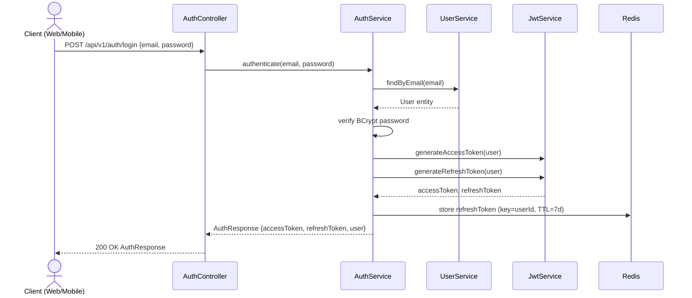
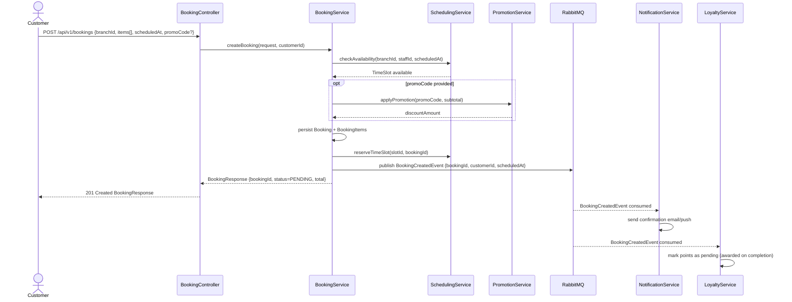
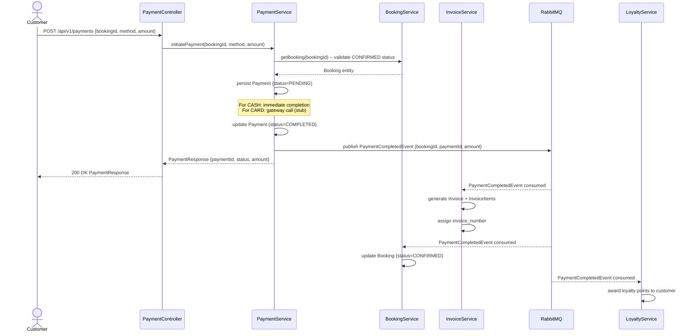
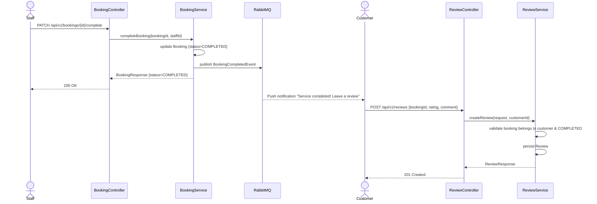
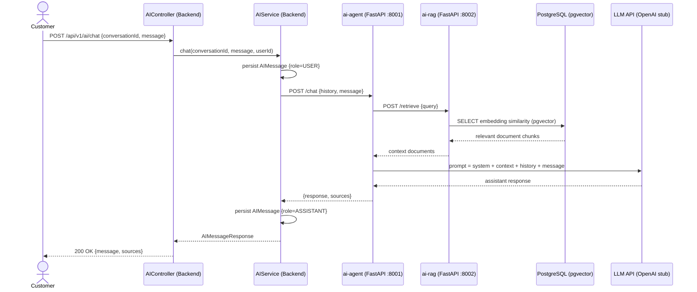
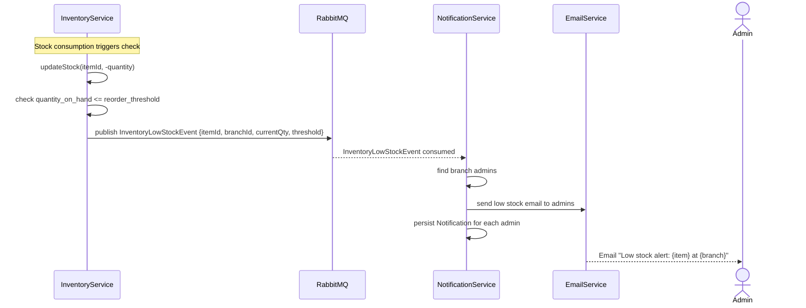
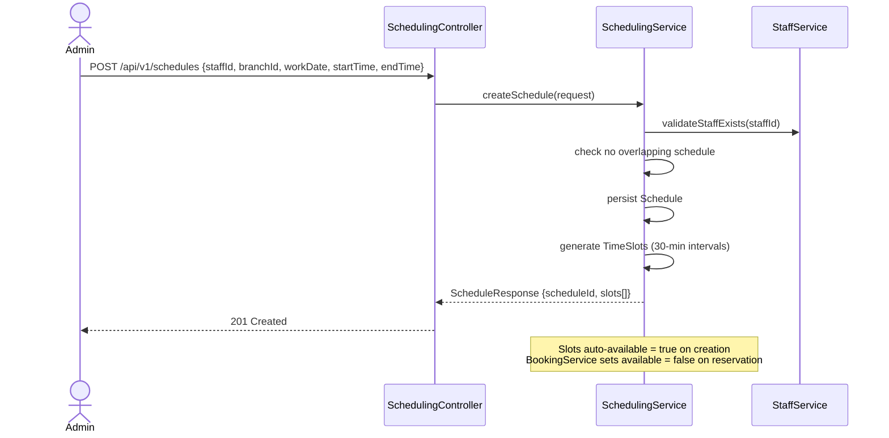

# Pet Care Platform — Sequence Diagrams

## 1. Authentication — Login Flow

---

## 2. Create Booking Flow

---

## 3. Payment Flow

---

## 4. Booking Completion & Review Flow

---

## 5. AI Chat (RAG) Flow

---

## 6. Inventory Low Stock Alert Flow

---

## 7. Staff Schedule & Slot Management

