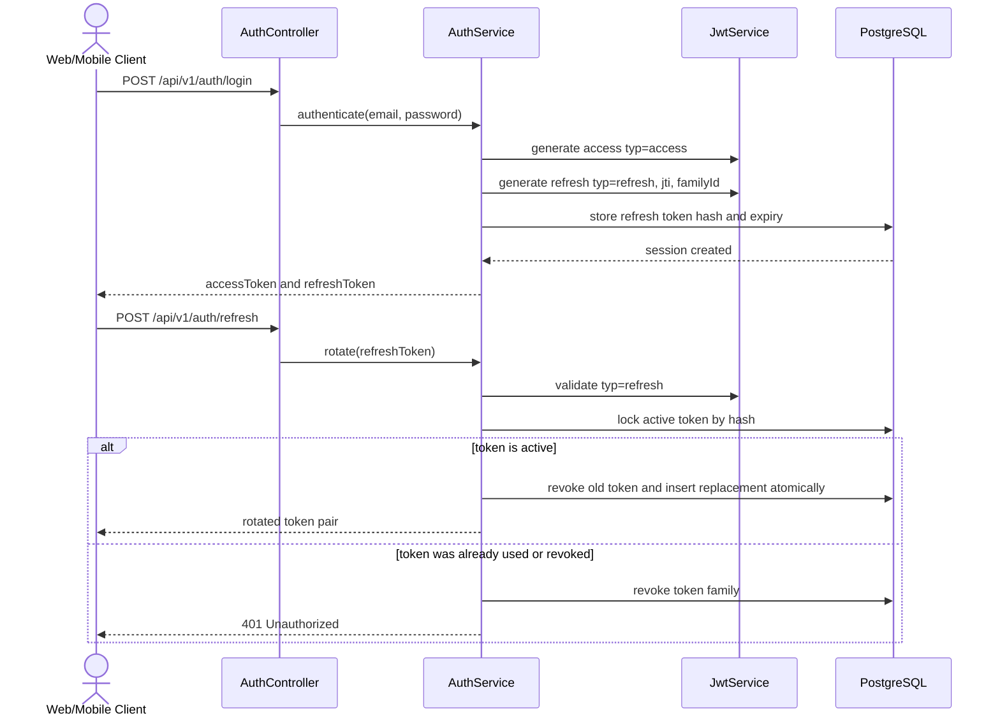
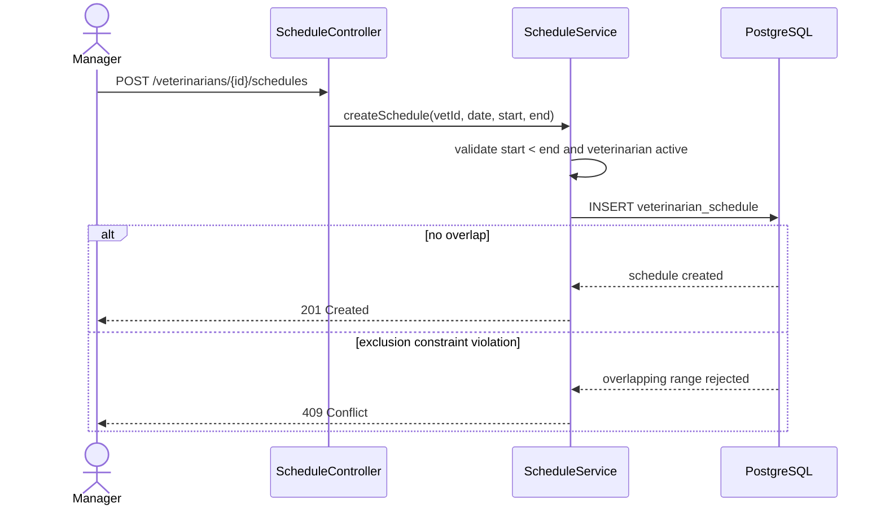
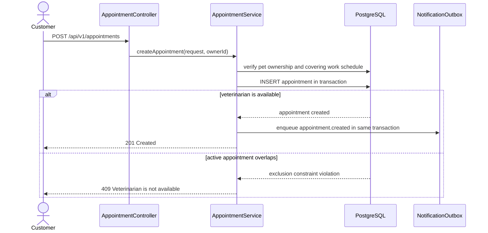
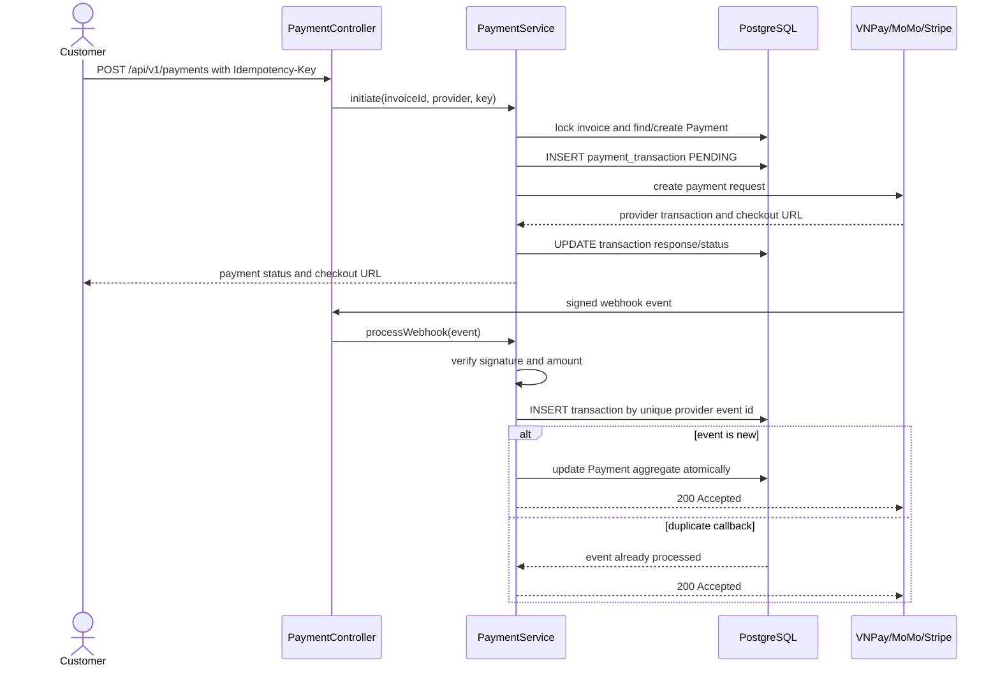
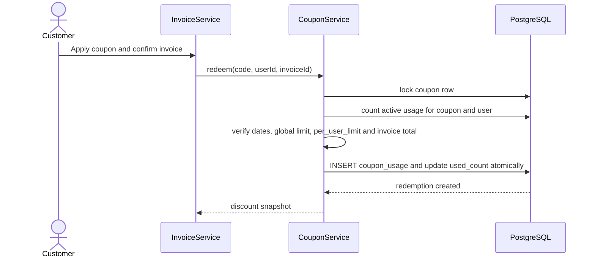
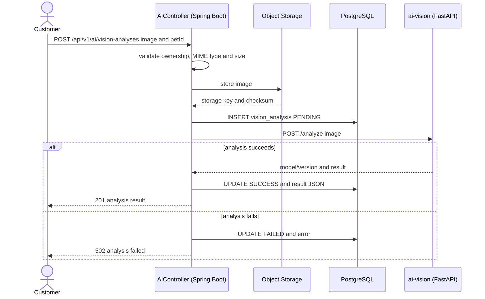
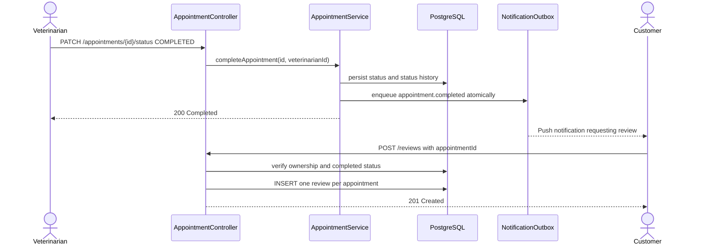

# Pet Care Platform - Sequence Diagrams

> Các flow dưới đây mô tả kiến trúc đích của MVP. Chúng chưa đồng nghĩa với việc controller/service tương ứng đã được triển khai trong `services/backend`.

## 1. Login And Refresh Rotation

The raw refresh token is never stored. Normal Bearer authentication accepts only `typ=access`; logout sets `revoked_at` for the selected session or token family.

## 2. Veterinarian Schedule

The database uses a half-open range `[start, end)`, so adjacent shifts are allowed. A single `UNIQUE(veterinarian_id, work_date)` must not be used because it prevents valid split shifts.

## 3. Create Appointment Without Double Booking

Availability checks improve the response but are not sufficient by themselves. The PostgreSQL exclusion constraint is the final concurrency-safe protection for `PENDING`, `CONFIRMED`, and `IN_PROGRESS` appointments.

## 4. Payment And Gateway Transactions

Refunds append `REFUND` transactions. Successful cumulative refunds must never exceed successful captures; gateway payload history is not overwritten on the parent payment row.

## 5. Coupon Redemption

`POST /coupons/validate` is advisory and does not consume a use. `UNIQUE(invoice_id)` prevents duplicate invoice redemption, while `per_user_limit` is enforced transactionally rather than by `UNIQUE(coupon_id, user_id)`.

## 6. Vision Analysis History

> ⚠ **Chưa được triển khai.** `AiController` hiện chỉ có `POST /api/v1/ai/tips` (stub, không gọi `ai-vision`), và Core DB **chưa có** bảng `vision_analyses` (xem migration đề xuất `P-36` trong `docs/api-contracts.md`).
> Endpoint chuẩn được chọn trong API contract là **`POST /api/v1/ai/vision/analyze`** (không phải `/api/v1/ai/vision-analyses` như trước đây). Khi triển khai phải cập nhật lại sơ đồ này cho khớp.

PostgreSQL stores only image metadata, ownership, model information and results. Image bytes remain in protected object storage and follow an explicit retention policy.

## 7. Appointment Completion And Review

